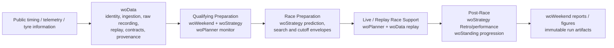

# woWeekend

[dr-wo project home](https://github.com/dr-wo/dr-wo) · [Interactive application](https://github.com/dr-wo/woPlanner) · [Analysis methods](https://github.com/dr-wo/woStrategy)

`woWeekend` turns the separate dr-wo packages into a repeatable Formula 1
race-weekend workflow: qualifying preparation, race preparation, live/replay
support and post-race review. It owns orchestration and portable reports while
leaving numerical methods and data contracts with their source packages.

All inputs are public F1 timing, telemetry and tyre information.

## End-to-end workflow



Ownership stays explicit: `woData` is the reproducible data and artifact layer;
`woStrategy` owns performance, tyre and strategy calculations; `woPlanner` owns
interactive qualifying/race support; `woStanding` owns championship analysis;
`woWeekend` coordinates those capabilities without duplicating them.

## Finished reports: 2026-R13 Italian Grand Prix

- **[Race Preparation report](examples/2026-R13/reports/race-preparation/2026_Italian_GP_PreRace_Strategy_Report_FP_Markers_en-GB.md)** — pre-race tyre assumptions, exact strategy search, stop-count cutoffs and FP diagnostic evidence.
- **[Post-Race Review](examples/2026-R13/reports/post-race/2026_R13_Italian_GP_Post_Race_Report_en-GB.md)** — causal replay, tyre-model evolution, sampler quality and the Retro Green Optimum.

[Browse the compact 2026-R13 example](examples/2026-R13/) for the exact
Race Preparation and historical Post-Race outputs selected from immutable local
runs, including assumptions, strategy rows, degradation cutoffs, live-MC history,
Retro comparison and known limitations.

<p>
  
  
</p>

The Race Preparation example completed successfully. The Post-Race example is
historical replay validation and is intentionally marked `PARTIAL`: every
implemented component succeeded, while Event-Aware Hindsight Optimum remains
unavailable because the deterministic SC/VSC counterfactual API has not yet
been extracted from `woPlanner`.

## Run a workflow

Use Python 3.10+ in an active environment and sibling checkouts of all five
components. From woWeekend, install the local packages together:

```bash
python -m pip install -e "../woData[live]" -e ../woStrategy -e ../woStanding -e ../woPlanner -e .
woweekend-race --generate-config race.example.json
woweekend-race --validate-config race.example.json
```

Review the generated config for the event, data root and operational assumptions
before running analysis. Race preparation requires a processed Pirelli preview;
missing public FP inputs may be downloaded. Numerical results, immutable run
artifacts and report bundles are distinct from the authored report narrative.

| Entry point | Role |
| --- | --- |
| `woweekend-quali` | Prepare qualifying analysis and planning inputs. |
| `woweekend-race` | Prepare tyre inputs, strategy searches and sensitivity reports. |
| `woweekend-post` | Assemble retrospective performance, tyre, replay and standings analysis. |
| `woweekend-traffic-history` | Explicitly prepare optional historical traffic context. |

## Methods and operation

- [Workflow guide](docs/WORKFLOW_GUIDE.md): prerequisites, operational inputs,
  report-only rendering and saved-run provenance.
- [Strategy sensitivity](https://github.com/dr-wo/woStrategy): exact search,
  evidence-aware degradation cutoffs and modelled undercut curves.
- [Data and run contracts](https://github.com/dr-wo/woData) and
  [championship progression](https://github.com/dr-wo/woStanding): the supporting layers.
- [Development guide](docs/AI_DEVELOPMENT_GUIDE.md): ownership and validation expectations.

The R13 example remains a fixed historical report. Newer analytical capabilities
are documented with their owning components rather than retroactively added to
that run's results.
