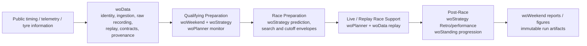

# woWeekend

`woWeekend` turns the separate dr-wo packages into a repeatable Formula 1
race-weekend workflow: qualifying preparation, race preparation, live/replay
support and post-race review. It owns orchestration and portable reports while
leaving numerical methods and data contracts with their source packages.

All inputs are public F1 timing, telemetry and tyre information.

## End-to-end workflow



Ownership stays explicit: `woData` is the reproducible data and artifact layer;
`woStrategy` owns performance, tyre and strategy calculations; `woPlanner` owns
interactive qualifying/race support; `woStanding` owns championship analysis;
`woWeekend` coordinates those capabilities without duplicating them.

## Finished reports: 2026-R13 Italian Grand Prix

- **[Race Preparation report](examples/2026-R13/reports/race-preparation/2026_Italian_GP_PreRace_Strategy_Report_FP_Markers_en-GB.md)** — pre-race tyre assumptions, exact strategy search, stop-count cutoffs and FP diagnostic evidence.
- **[Post-Race Review](examples/2026-R13/reports/post-race/2026_R13_Italian_GP_Post_Race_Report_en-GB.md)** — causal replay, tyre-model evolution, sampler quality and the Retro Green Optimum.

[Browse the compact 2026-R13 example](examples/2026-R13/) for the exact
Race Preparation and historical Post-Race outputs selected from immutable local
runs, including assumptions, strategy rows, degradation cutoffs, live-MC history,
Retro comparison and known limitations.

<p>
  
  
</p>

The Race Preparation example completed successfully. The Post-Race example is
historical replay validation and is intentionally marked `PARTIAL`: every
implemented component succeeded, while Event-Aware Hindsight Optimum remains
unavailable because the deterministic SC/VSC counterfactual API has not yet
been extracted from `woPlanner`.

## Operator interface

The three preparation/review stages are independently invokable. Numerical
analysis remains in `woStrategy`, data paths and immutable run storage remain in
`woData`, standings remain in `woStanding`, and GUI/manual controls remain in
`woPlanner`.

```bash
woweekend-quali --event 2026-07 --config qualifying.json
woweekend-race --event 2026-07 --config race.json
woweekend-post --event 2026-07 --config post_race.json
```

Generate or validate self-documenting configuration:

```bash
woweekend-race --generate-config race.json
woweekend-race --validate-config race.json
```

The repository also keeps current operator configs under `configs/`. The
current race config is the editable event-specific source; its race distance
and pit-loss values must be read from the file rather than inferred from older
run artifacts. With no manual tyre-model overrides, the cached pre-race tyre
prediction remains the source of compound performance and degradation values.
The checked-in qualifying config uses a 5% push-lap threshold.

Race Preparation reports the supporting FP tyre evidence with AirTemp and
TrackTemp ranges and coverage by session and compound when report v2 provenance
is available. This context comes from the actual supporting laps and runs and
is reporting-only; it does not alter the tyre model, Monte Carlo results or
strategy search. The report adapter accepts context only when its `analysis_id`
and `model_created_at` match the current persisted model instance. Missing,
legacy, unbound or stale provenance is shown explicitly as unavailable. Expert
CSV temperature sampling cadence may be unknown, and a recorded zero remains
visible and flagged.

After manually downloading/processing the Pirelli preview with Codex, run Race
Preparation once from the `woWeekend` checkout:

```bash
woweekend-race --event 2026-16 --config configs/race.json
```

The command now validates the accepted event JSON at
`woData/pirelli_preview/year=2026/extracted/round=16.json`, ensures the event's FP
data, prepares the tyre inputs, and then runs the existing race analysis. Its
producer path is:

1. `wodata.script.fetch_replay_data.run_fetch_replay_data` downloads/reuses raw FP
   archives, including telemetry, under `wodata/live_archive/schema_v1/`. Replay
   building/playback is unnecessary for the tyre model and is disabled here.
2. `wostrategy.core.pre_race_session_data.load_cached_weekend_sessions` ensures
   enriched, current-contract laps under `fastf1/session_laps/schema_v1/` using
   its existing cache-first FastF1 timing/telemetry derivation. The raw replay
   archive and the enriched analysis cache are distinct existing data products.
3. `wostrategy.analysis.tyre_prediction_pipeline.run_tyre_prediction_pipeline`
   uses `processed_previews_only=True`: it rebuilds the descriptor CSV from
   processed JSONs, reads existing Race Retro summaries, and runs the unchanged
   prediction model. It never scans/extracts preview images or invokes vision.
   Its independent historical FP calibration refresh stays in the explicit
   post-Retro diagnostic workflow (`refresh_fp_calibration=False` here); it is
   not a production tyre input. Saved causal calibration remains available to
   the existing FP evidence report, with its normal unavailable status if absent.
4. `wostrategy.analysis.pre_race_model_config.ensure_pre_race_model_config`
   ensures the FP evidence and live model config through the canonical
   `wostrategy.script.pre_race_analysis.run_from_script_config` producer.
5. The existing `run_race` loads that canonical prediction, applies configured
   overrides, runs exact strategy search and degradation cutoffs, and creates
   the portable report bundle. `pre_race_prerequisites.json` records acquisition
   paths, cache sources, prediction identity and model generation/reuse.

Practice sessions come from the event schedule: conventional events use FP1–FP3;
sprint events use the practice sessions actually present. Missing required FP
laps, unaccepted/wrong-event/changed-image Pirelli input, incomplete tyre
predictions, and unusable FP model evidence stop at their stage before race-run
creation. The command exits nonzero on failure. Config generation/validation and
`--report-only` do not acquire data or run prerequisites.

Reruns reuse woData archives and compatible enriched laps, retain fingerprinted
tyre prediction versions, and reuse fresh FP model artifacts. Each race analysis
still creates its normal immutable run. The shared data root follows `data_root`,
`WODATA_ROOT`, `WOSTRATEGY_DATA_ROOT`, then the sibling `woData` checkout.

The human-authored inputs are accepted processed Pirelli JSONs and event-specific
GREEN pit loss, supplied directly in `pit_loss.green` or through the same
`woweekend-race` invocation's `--pit-loss-total` / `--pit-in-s3` and `--pit-out-s1`
options. There is no separate pit-loss preparation command. An explicit
`race.total_laps` input is needed only when canonical metadata and FastF1 cannot
resolve the distance. Pirelli download/extraction/processing stays external.

Historical Race Retro summaries and accepted historical Pirelli records are
accumulated training support from completed events, not a target-event pre-race
command to run. Their Race evidence cannot be manufactured by another pre-race
invocation. The orchestrator already extracts observations from saved summaries,
joins the training data, checks model readiness, and produces the target tyre
prediction. Insufficient historical support remains a data-quality blocker with
a clear tyre-stage failure; historical Retro production stays unchanged.

No additional required per-event manual command remains between Pirelli
processing and `woweekend-race`. Optional Historical Traffic, interruption-history
acquisition, and historical FP calibration remain their explicit diagnostic
workflows; they are not required generated prerequisites of this command.

`tyre_prediction.manual_override` continues to override the automatically
prepared values. Embedded callers of `run_race` also retain the complete-manual
fallback by supplying both tyre fields for SOFT, MEDIUM, and HARD. Canonical and
complete-manual values may use any common additive performance baseline; the
shared operational boundary validates them and normalizes MEDIUM to zero.

Regenerate presentation artifacts without rerunning deterministic analysis:

```bash
woweekend-race --event 2026-07 --report-only RUN_ID --language en-GB
```

Post-Race reconstructs the historical live tyre-MC sequence before presenting
the separate full-race Retro MC result. It first merges complete local live
recording fragments, then reuses or downloads the canonical archive replay when
the recovered record lacks race distance or tyre metadata. Every leader-lap
cut is passed to woPlanner's existing live recalculation service; Post does not
contain another MC implementation.

Post-Race also runs the frozen `projected_mean` **BSF Junction Engineering
Reference** immediately after canonical race-performance tracker processing.
It consumes the already persisted canonical producer inputs. The run stores
`bsf_junction_reference/bsf_junction_reference.current.csv`,
`bsf_junction_reference.season.csv` and `bsf_junction_reference.season.json`.
The separate event cache in woData retains source hashes, full methodology,
limitations, P/F/N flags and score-path provenance. Completed historical BSF
events require compatible numerical kernels and approved source identities.
The closed 2026 R1–R15 set can rebuild only from verified originals (R15 uses
the original range=1–15 bank); newer producer files cannot replace it.
Missing histories are explicitly listed and shown as
unavailable cells. A current-event failure marks this optional component FAILED
and the overall run PARTIAL, preserving successful canonical outputs and report
generation. No substitute is supplied.

The three run figures are `bsf_junction_reference_mercedes.png`,
`bsf_junction_reference_minus_canonical.png` and
`bsf_junction_reference_support.png`. The authoring bundle reserves both primary
tracker attachments and includes `BSF_JUNCTION_REFERENCE.md` with its saved
caption/caveats. Report instructions place this fragment immediately after the
existing canonical long-run tracker section and before its existing next section.
The normal authoring step still supplies the report prose; deterministic final
assembly preserves that prose and inserts/replaces only this companion section:

```bash
woweekend-post --event 2026-15 --report-only RUN_ID --language en-GB --report-draft authored_report.md
```

Final assembly uses the successful saved component and figure manifest as the
only authority for BSF images. Failed/unavailable companions remove old BSF
sections and images throughout the authored draft, including supplementary
diagnostics, while preserving unrelated figures. Only references in the final
assembled report are copied, and assembly provenance is recorded. It never
recalculates either estimator. BSF is an
experimental companion/reference, not a second authoritative ranking. P means
projected support, F canonical fallback and N prior-only completion. P is not a
confidence grade; N has no performance-axis marker. Negative BSF values are
faster than Mercedes in seconds/lap. This is not equal-fuel, age-zero or pure car
performance. The full frozen method/input contract and limitations are documented
in woStrategy's “BSF Junction Engineering Reference companion” workflow section.

Race Preparation now ensures woPlanner's event-specific live-MC
`model_config.json` exists by reusing woStrategy's canonical pre-race producer.
Post repeats that inexpensive validation and automatically generates a missing
or stale historical prerequisite before replay. Operators do not need to run
`wostrategy.script.pre_race_analysis` separately. The manifest records whether
the config was `reused` or `generated`; a genuine generation failure is isolated
to live-MC history in Post.

```json
{
  "live_replay": {
    "mode": "algorithm_only"
  }
}
```

`algorithm_only` ignores recorded manual overrides. `operational` preserves the
calculated MC coordinates and separately reconstructs recorded manual and
effective values. The compact `live_mc_history.json` artifact and two English
evolution figures are included in the report bundle when replay succeeds;
replay failure does not stop other Post components.

Degradation history uses woPlanner's shared live compound resolver. The figure
plots effective values with dotted `base`, dashed `live_derived`, and solid
`live_direct` lines; recorded operational overrides use `manual_override`.
Compounds without direct evidence can therefore evolve through the initial
degradation ratios. See [the R13 report fix](docs/LIVE_MC_DEGRADATION_HISTORY.md)
for the data contract and regression coverage.

The validation, legacy compatibility boundary, and deliberate freshness/runtime
compromises are documented in
[docs/LIVE_MC_MODEL_CONFIG_PREREQUISITE.md](docs/LIVE_MC_MODEL_CONFIG_PREREQUISITE.md).

`configs/race.json` is the editable current-event operational source for race
distance and pit loss. Pit loss can be supplied as one whole value; no S3/S1
split is required:

```json
{
  "pit_loss": {
    "green": {"total": 20.5},
    "sc": {"total": 15.0},
    "vsc": {"total": 11.3},
    "sc_vsc": {"total": null}
  }
}
```

For each state, use `total` or the `pit_in_s3` + `pit_out_s1` pair, never both.
`sc_vsc` is retained only to read legacy combined evidence; it is never copied
into the separate operational SC and VSC values. Planner reads this file and
writes it only when **Apply pit losses** is pressed. The same Apply operation
replaces the latest event-scoped operational-history record under
`woData/woweekend/event_operational_inputs/schema_v1/year=YYYY/round=RR/`.
That history is a durable mirror, not a second editable source. Changing the
current config to the next event does not erase the completed event's record.

**R16 DBG-5: CLOSED (2026-10-08) — documentation/readiness only.** Pre-race VSC
pit loss is an optional, explicitly adopted, event-specific operational assumption.
R16's archived input already contained explicit VSC `null`; resolution and Planner
correctly preserved **Unresolved**. Author a separate `pit_loss.vsc` total or complete
S3/S1 loss pair in this config, or use DBG-9's manual VSC override in standard
Planner when a value is needed. The override is immediately effective; **Apply
pit losses** persists it to this authoritative config and the woData mirror.
Clearing the override restores the underlying value; Apply persists the removal.
Unresolved VSC does not block preparation that only needs GREEN. This closure adds
no estimation, fallback, readiness blocking, automatic propagation, or UI behavior.

The four persistence roles are intentionally distinct: `configs/race.json` is
the editable current operational config; a run's `config.resolved.json` is its
immutable input snapshot; the woData event record preserves the latest/final
operational assumptions adopted for that event; and Post-Race run artifacts
contain empirical observations. Prior-event operational assumptions and
empirical evidence may both appear in a future report, in separately labelled
sections, but neither can populate current calculations or Planner fields.
When a stable same-circuit identity is unavailable or ambiguous the report says
so instead of guessing from a display name.

An explicit `race.total_laps` is authoritative. When it is null, Race Preparation
uses the existing canonical race-distance chain and records the resolved result
in both that run's immutable `config.resolved.json` and the durable woData event
record. The history writer receives this already-resolved value; it does not run
another session lookup, and successful resolution does not require rewriting the
editable null in `configs/race.json`.

Post-Race empirical pit-loss evidence remains separate from operational history.
For example, an event may retain an operational VSC assumption of `12.0 s` and a
supported post-race empirical VSC result of `11.8 s`. A future report may show
both as separately labelled previous-event context, but neither auto-fills or
becomes the next event's operational VSC input.
The empirical estimator measures GREEN-relative pit-sector excess, not the
operational Planner VSC loss against staying out under VSC. These quantities are
not semantically interchangeable merely because both are measured in seconds.

The suspicious archived R16 event identity and historical lookup misses are
tracked separately in [R16 event identity debug item](docs/R16_EVENT_IDENTITY_DEBUG.md);
they are not part of DBG-5's closure.

## Degradation cutoff scan

Race Preparation keeps MEDIUM as the degradation scan variable, preserves the
predicted S:M:H degradation ratios, and holds compound performance deltas fixed.
It generates both unrestricted and rules-compliant fixed-stop envelopes.

With `degradation_cutoff.scan_min: null`, the normal prediction-centred scan is
run first. If it does not bracket a positive 1→2 cutoff, the lower bound is
progressively extended toward zero. The search stops when it finds a bracket or
reaches zero, and never evaluates negative degradation. A numeric `scan_min` is
a hard user boundary and disables extension below that value.

Artifacts record the predicted MEDIUM degradation, initial and effective lower
bounds, cutoff values, and a 1→2 search status. A search that reaches zero
without a positive crossing reports `no_positive_degradation_crossing`; it does
not describe the result merely as outside the initial range. Cutoff figures
label the prediction and each available 1→2 and 2→3 cutoff.

When persisted FP evidence contains a usable MEDIUM degradation coordinate, the
same figures add visibly distinct `FP1 diagnostic`, `FP2 diagnostic` and `FP3
diagnostic` reference lines. These do not alter the envelope or constitute an FP
strategy: absolute degradation remains confounded with fuel/load in the current
practice model, while compound performance is not independently identifiable.
The marker values and limitations are also stored in cutoff/report JSON.

Assumptions and compatibility choices:

- the existing exact optimiser and crossing refinement define each cutoff;
- the automatic extension applies only to 1→2, while existing 2→3 scan logic
  and non-monotonic warnings are preserved;
- zero may be evaluated as the terminal boundary, but a crossing exactly at zero
  is not considered a positive-degradation cutoff;
- the tyre prediction model is consumed unchanged.

Current compromises and follow-up work are documented in
`woStrategy/doc/DEGRADATION_CUTOFF.md`. In particular, extension uses
deterministic bound halving, status values remain strings for artifact
compatibility, and any future 2→3 extension should be designed separately.

Runs are stored beneath
`<WODATA_ROOT>/woweekend/runs/schema_v1/event=<event>/workflow=<workflow>/runs/<run_id>`.
Each run keeps input/resolved configs, small deterministic outputs, a manifest,
and a ChatGPT-ready bundle of at most 20 files. Heavy reusable caches are stored
as exact references with provenance and are never silently replaced by `latest`.

See [AUDIT.md](AUDIT.md) for the audit-first reuse map and known extraction gap
for the Event-Aware Hindsight Optimum.

Future maintainers and AI development agents should start with
[docs/AI_DEVELOPMENT_GUIDE.md](docs/AI_DEVELOPMENT_GUIDE.md). It describes the
repository boundaries, workflow/data flow, deterministic artifacts, test
strategy, and the assumptions and compromises behind the current design.

This project is developed extensively with coding agents. The guide is durable
engineering context, not hidden implementation history.

### Historical interruption section in race-preparation reports

Run woStrategy's explicit `python -m wostrategy.script.interruption_history --event
YYYY-RR --data-root <data_root>` preparation before the race workflow when this
optional context is wanted. Acquisition is not performed during report assembly.
The workflow reads woData's canonical
`wostrategy/interruption_history/schema_v1/year=YYYY/round=RR/history.json`, snapshots
it as `historical_interruptions.json`, and includes it in component output and
`report_context.json`. Report bundles contain a deterministic
`HISTORICAL_INTERRUPTION_CONTEXT.md` section/table and instructions to include it.
Regeneration uses the run's saved history snapshot, preserving the original report
values even if the canonical prepared artifact later changes. Legacy run bundles
show explicit unavailable context. The bundle still honors its 20-file limit.
woPlanner's Strategy Prediction **History Info** tab reads the same canonical input.

The history selects the latest five **prior races at the same venue**, including
skipped years and multiple races in a season. It excludes the target, later rounds,
and races not proved earlier than both the target race and acquisition cutoff.
Missing/`NaT` race dates fall back through `Session5DateUtc`, `Session5Date` and
`EventDate`; a same-season edition without chronological evidence is excluded and
selection is marked incomplete. A date-only value on the cutoff day is ambiguous.
Matching reuses woData's operational identity policy: circuit ID, then
country/location, then circuit text; event display names are not keys. Available
identity and schedule provenance are retained. Layout changes are not inferred,
normalized or excluded; venue identity does not assert equivalent layouts.

Only race-time Safety Car (`TrackStatus=4`) and Red Flag (`5`) occurrences are
inventoried; pure VSC (`6`/`7`) is excluded. Stable timestamp/source order preserves
multiple events within a lap, while contiguous repeated messages add no occurrence.
An unknown interval can split one minimum occurrence into uncertain fragments:
`SC → unknown → SC` proves **at least one**, not two. Only a trusted differing status
proves an intervening exit and supports another distinct minimum occurrence.
Fragments retain unknown boundaries and may represent separate deployments.

FastF1's first SessionStatus `Started` is an initial candidate. A non-generated raw
race-lap completion after that candidate and before suspension/start-abort
corroborates genuine racing and locks the original start. Before corroboration,
a mapped explicit `START ABORTED`/`ABORTED START` can move the candidate to a later
`Started`; after corroboration, later aborted restarts never replace it. Missing or
conflicting original-start/abort evidence leaves admission ambiguous. Raw completed
race laps at or before any candidate `Started` prevent treating a restart as the
original start, even if a backmarker completes the same lap later. Prior suspension
or abort evidence does not override those earlier completions. This also
conservatively leaves a race suspended before its first reliable completed lap
ambiguous. Formation interruptions ending before the admitted start are excluded;
a pre-start SC/RF still active at the start has no proven post-start deployment and
is excluded with a coverage warning.

Approximate leader boundaries require independent original timing-stream evidence:
reported `Position=1` on consecutive leader lap labels `LAP N → LAP N+1` identifies
the driver completing lap N. woData acquires that stream through FastF1's existing
cached timing API; woStrategy uses only that driver's non-generated raw `laps.Time`
for the boundary. FastF1's `laps.Position` ranks remaining completion rows and is
not authority evidence. A missing leader row/time, missing independent lap advance,
or unknown generation flag leaves the boundary unavailable; neither a later
backmarker nor a later leader report repairs it. Raw session elapsed time includes
suspension gaps. Non-monotonic/inconsistent chains still fail closed, and a missing
boundary needed for an interval yields `lap=null` while retaining the occurrence.

**The displayed SC range is the set of laps during which SC status was active for
any portion of the lap.** Entry uses `[lap start, lap end)` and withdrawal uses
`(lap start, lap end]`: partial L11 through partial L13 displays `~L11–13`, while
withdrawal exactly at the L1 completion displays `~L1`, excluding L2. A direct
SC → Red Flag transition ends the SC there and is labelled accordingly. Red Flag
uses only its entry lap, never a suspension-duration range. Zero-duration updates
at a boundary retain the occurrence with unavailable lap context.

`schema_version=1`, `semantic_role=historical_race_interruptions` preserves the
target, newest-first identities, selection provenance, source integrity evidence,
start-admission evidence, coverage reasons, timeline hash, and SC/Red Flag families.
Each family has `occurred` (true/false/null), `count` (exact integer/null),
`observed_count` (minimum distinct occurrences), and chronological `occurrences`
with cross-family sequence, original seconds/source indexes, uncertain fragments,
trusted exit proof and approximate/unavailable laps. Missing deployment boundaries
retain `start_seconds=null`, unavailable start laps and `first_observed_seconds`.
Validation rejects unsupported enums, inconsistent null/timestamp/lap values,
backwards/overlapping known intervals, unsupported grouping, contradictory counts,
missing provenance, and complete records lacking required deployment boundaries.
Legitimate partial/ambiguous records remain representable. Unsupported older draft
artifacts degrade to unavailable and must be explicitly prepared again.

**Confirmed zero requires affirmative TrackStatus integrity**, supported original
race admission, start baseline, terminal lifecycle, valid transitions and
unambiguous required deployment boundaries. The source must explicitly provide
`track_status_integrity.status=verified_complete` with nonempty evidence identifying
a completeness/integrity check. A boolean, lifecycle completion, timeline hash,
HTTP success or parser-version match is insufficient. The inspected FastF1 3.8.3
TrackStatus parser/cache provides no such signal: its adapter emits integrity
`unknown` with no affirmative evidence. Therefore its historical empty streams
show **No event observed; coverage unproven**, never confirmed “No SC”/“No Red Flag”.
Observed positive events remain confirmed minimums with null exact totals, shown as
**at least N (incomplete)**. Only explicit integrity-checked fixture sources currently
exercise confirmed-zero behavior. Report and Planner use the same local artifact
and formatting; neither acquires data on render/reload. This descriptive context
never changes strategy, probabilities or operational inputs.

### Historical Traffic in the final pre-race report

Historical traffic uses the existing optional-context convention: explicitly
prepare it with `woweekend-traffic-history --circuit <calendar Location>
--target-season <season> --data-root <data_root>`, then run normal race preparation.
The workflow locates the validated woData artifact, snapshots its context and
figures, and records reuse/unavailable status. Missing or stale optional history
renders an explicit unavailable section; report rendering does not prepare it.

The normal bundle includes `HISTORICAL_TRAFFIC_CONTEXT.md`, the three-group
summary/conclusions and five distribution figures. Its authoring instructions
place **Historical Traffic immediately before Limitations**. For deterministic
final assembly of an authored pre-race Markdown draft:

```sh
woweekend-race --event YYYY-RR --config configs/race.json --report-draft report.md
# Or assemble from the saved run without repeating preparation/calculation:
woweekend-race --event YYYY-RR --report-only RUN_ID --language en-GB --report-draft report.md
```

The existing draft must contain a level-2 Limitations heading (numbered headings
and “Limitations and provenance” are supported). Final assembly inserts/replaces
only Historical Traffic, preserves the other authored sections, and reads the
run's saved bundle rather than canonical latest history. Output is an immutable
`final_report.<language>.<template>/pre_race_report.md` with colocated figures and
assembly provenance. Authoring/numerical review of the other report sections
continues to follow the existing report-bundle process.

Historical VSC five-year evidence-only policy: [M2](docs/HISTORICAL_VSC_M2.md).
