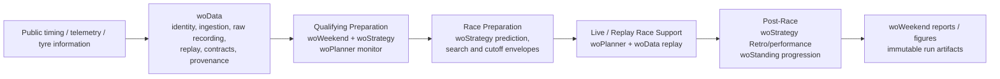
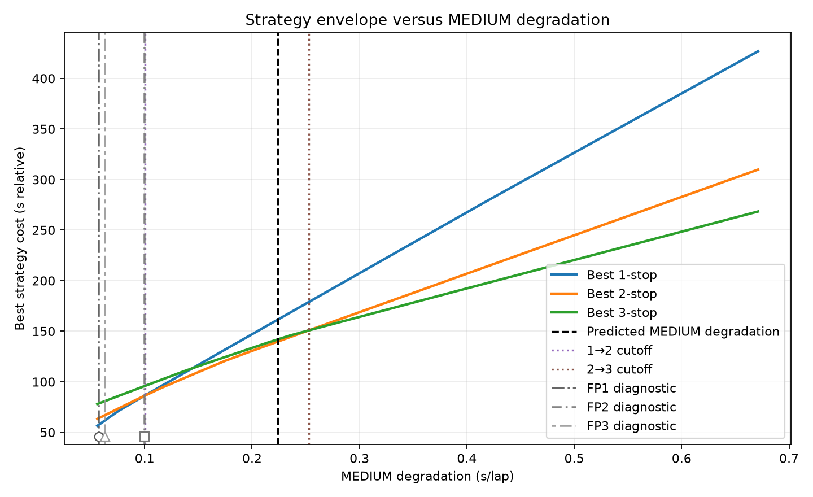
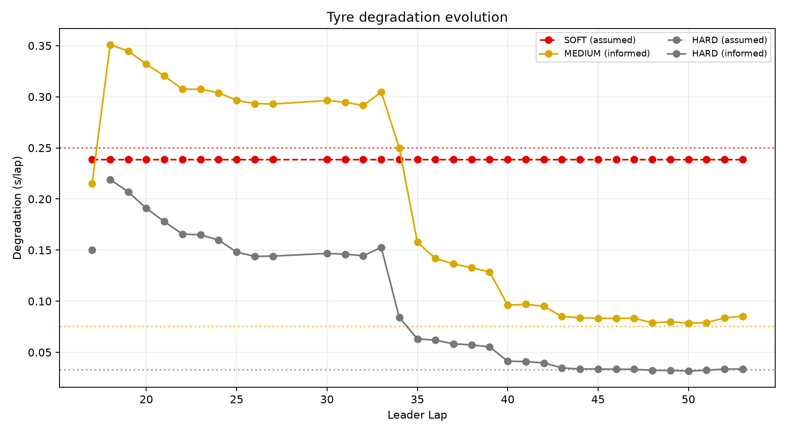

# woWeekend

`woWeekend` turns the separate dr-wo packages into a repeatable Formula 1
race-weekend workflow: qualifying preparation, race preparation, live/replay
support and post-race review. It owns orchestration and portable reports while
leaving numerical methods and data contracts with their source packages.

All inputs are public F1 timing, telemetry and tyre information.

## End-to-end workflow



Ownership stays explicit: `woData` is the reproducible data and artifact layer;
`woStrategy` owns performance, tyre and strategy calculations; `woPlanner` owns
interactive qualifying/race support; `woStanding` owns championship analysis;
`woWeekend` coordinates those capabilities without duplicating them.

## Finished reports: 2026-R13 Italian Grand Prix

- **[Race Preparation report](examples/2026-R13/reports/race-preparation/2026_Italian_GP_PreRace_Strategy_Report_FP_Markers_en-GB.md)** — pre-race tyre assumptions, exact strategy search, stop-count cutoffs and FP diagnostic evidence.
- **[Post-Race Review](examples/2026-R13/reports/post-race/2026_R13_Italian_GP_Post_Race_Report_en-GB.md)** — causal replay, tyre-model evolution, sampler quality and the Retro Green Optimum.

[Browse the compact 2026-R13 example](examples/2026-R13/) for the exact
Race Preparation and historical Post-Race outputs selected from immutable local
runs, including assumptions, strategy rows, degradation cutoffs, live-MC history,
Retro comparison and known limitations.

<p>
  
  
</p>

The Race Preparation example completed successfully. The Post-Race example is
historical replay validation and is intentionally marked `PARTIAL`: every
implemented component succeeded, while Event-Aware Hindsight Optimum remains
unavailable because the deterministic SC/VSC counterfactual API has not yet
been extracted from `woPlanner`.

## Operator interface

The three preparation/review stages are independently invokable. Numerical
analysis remains in `woStrategy`, data paths and immutable run storage remain in
`woData`, standings remain in `woStanding`, and GUI/manual controls remain in
`woPlanner`.

```bash
woweekend-quali --event 2026-07 --config qualifying.json
woweekend-race --event 2026-07 --config race.json
woweekend-post --event 2026-07 --config post_race.json
```

Generate or validate self-documenting configuration:

```bash
woweekend-race --generate-config race.json
woweekend-race --validate-config race.json
```

The repository also keeps current operator configs under `configs/`. The
current race config is the editable event-specific source; its race distance
and pit-loss values must be read from the file rather than inferred from older
run artifacts. With no manual tyre-model overrides, the cached pre-race tyre
prediction remains the source of compound performance and degradation values.
The checked-in qualifying config uses a 5% push-lap threshold.

Race Preparation reports the supporting FP tyre evidence with AirTemp and
TrackTemp ranges and coverage by session and compound when report v2 provenance
is available. This context comes from the actual supporting laps and runs and
is reporting-only; it does not alter the tyre model, Monte Carlo results or
strategy search. The report adapter accepts context only when its `analysis_id`
and `model_created_at` match the current persisted model instance. Missing,
legacy, unbound or stale provenance is shown explicitly as unavailable. Expert
CSV temperature sampling cadence may be unknown, and a recorded zero remains
visible and flagged.

Race Preparation requires the separate canonical pre-race tyre prediction
before it creates a run or performs downstream preparation. If that event
artifact is missing, complete the owning workflow first from `woStrategy`:

```bash
PYTHONPATH=../woData/src:src python -m wostrategy.script.tyre_prediction_pipeline --year 2026
```

Preview-image extraction remains an explicit operator/Codex step; Race
Preparation does not invoke an image/API extractor. The complete-manual fallback
remains available by supplying both tyre fields for SOFT, MEDIUM, and HARD under
`tyre_prediction.manual_override`. Canonical and complete-manual values may use
any common additive performance baseline; the shared operational boundary
validates them and normalizes MEDIUM to zero before downstream work.

Regenerate presentation artifacts without rerunning deterministic analysis:

```bash
woweekend-race --event 2026-07 --report-only RUN_ID --language en-GB
```

Post-Race reconstructs the historical live tyre-MC sequence before presenting
the separate full-race Retro MC result. It first merges complete local live
recording fragments, then reuses or downloads the canonical archive replay when
the recovered record lacks race distance or tyre metadata. Every leader-lap
cut is passed to woPlanner's existing live recalculation service; Post does not
contain another MC implementation.

Race Preparation now ensures woPlanner's event-specific live-MC
`model_config.json` exists by reusing woStrategy's canonical pre-race producer.
Post repeats that inexpensive validation and automatically generates a missing
or stale historical prerequisite before replay. Operators do not need to run
`wostrategy.script.pre_race_analysis` separately. The manifest records whether
the config was `reused` or `generated`; a genuine generation failure is isolated
to live-MC history in Post.

```json
{
  "live_replay": {
    "mode": "algorithm_only"
  }
}
```

`algorithm_only` ignores recorded manual overrides. `operational` preserves the
calculated MC coordinates and separately reconstructs recorded manual and
effective values. The compact `live_mc_history.json` artifact and two English
evolution figures are included in the report bundle when replay succeeds;
replay failure does not stop other Post components.

Degradation history uses woPlanner's shared live compound resolver. The figure
plots effective values with dotted `base`, dashed `live_derived`, and solid
`live_direct` lines; recorded operational overrides use `manual_override`.
Compounds without direct evidence can therefore evolve through the initial
degradation ratios. See [the R13 report fix](docs/LIVE_MC_DEGRADATION_HISTORY.md)
for the data contract and regression coverage.

The validation, legacy compatibility boundary, and deliberate freshness/runtime
compromises are documented in
[docs/LIVE_MC_MODEL_CONFIG_PREREQUISITE.md](docs/LIVE_MC_MODEL_CONFIG_PREREQUISITE.md).

`configs/race.json` is the editable current-event operational source for race
distance and pit loss. Pit loss can be supplied as one whole value; no S3/S1
split is required:

```json
{
  "pit_loss": {
    "green": {"total": 20.5},
    "sc": {"total": 15.0},
    "vsc": {"total": 11.3},
    "sc_vsc": {"total": null}
  }
}
```

For each state, use `total` or the `pit_in_s3` + `pit_out_s1` pair, never both.
`sc_vsc` is retained only to read legacy combined evidence; it is never copied
into the separate operational SC and VSC values. Planner reads this file and
writes it only when **Apply pit losses** is pressed. The same Apply operation
replaces the latest event-scoped operational-history record under
`woData/woweekend/event_operational_inputs/schema_v1/year=YYYY/round=RR/`.
That history is a durable mirror, not a second editable source. Changing the
current config to the next event does not erase the completed event's record.

The four persistence roles are intentionally distinct: `configs/race.json` is
the editable current operational config; a run's `config.resolved.json` is its
immutable input snapshot; the woData event record preserves the latest/final
operational assumptions adopted for that event; and Post-Race run artifacts
contain empirical observations. Prior-event operational assumptions and
empirical evidence may both appear in a future report, in separately labelled
sections, but neither can populate current calculations or Planner fields.
When a stable same-circuit identity is unavailable or ambiguous the report says
so instead of guessing from a display name.

An explicit `race.total_laps` is authoritative. When it is null, Race Preparation
uses the existing canonical race-distance chain and records the resolved result
in both that run's immutable `config.resolved.json` and the durable woData event
record. The history writer receives this already-resolved value; it does not run
another session lookup, and successful resolution does not require rewriting the
editable null in `configs/race.json`.

Post-Race empirical pit-loss evidence remains separate from operational history.
For example, an event may retain an operational VSC assumption of `12.0 s` and a
supported post-race empirical VSC result of `11.8 s`. A future report may show
both as separately labelled previous-event context, but neither auto-fills or
becomes the next event's operational VSC input.

## Degradation cutoff scan

Race Preparation keeps MEDIUM as the degradation scan variable, preserves the
predicted S:M:H degradation ratios, and holds compound performance deltas fixed.
It generates both unrestricted and rules-compliant fixed-stop envelopes.

With `degradation_cutoff.scan_min: null`, the normal prediction-centred scan is
run first. If it does not bracket a positive 1→2 cutoff, the lower bound is
progressively extended toward zero. The search stops when it finds a bracket or
reaches zero, and never evaluates negative degradation. A numeric `scan_min` is
a hard user boundary and disables extension below that value.

Artifacts record the predicted MEDIUM degradation, initial and effective lower
bounds, cutoff values, and a 1→2 search status. A search that reaches zero
without a positive crossing reports `no_positive_degradation_crossing`; it does
not describe the result merely as outside the initial range. Cutoff figures
label the prediction and each available 1→2 and 2→3 cutoff.

When persisted FP evidence contains a usable MEDIUM degradation coordinate, the
same figures add visibly distinct `FP1 diagnostic`, `FP2 diagnostic` and `FP3
diagnostic` reference lines. These do not alter the envelope or constitute an FP
strategy: absolute degradation remains confounded with fuel/load in the current
practice model, while compound performance is not independently identifiable.
The marker values and limitations are also stored in cutoff/report JSON.

Assumptions and compatibility choices:

- the existing exact optimiser and crossing refinement define each cutoff;
- the automatic extension applies only to 1→2, while existing 2→3 scan logic
  and non-monotonic warnings are preserved;
- zero may be evaluated as the terminal boundary, but a crossing exactly at zero
  is not considered a positive-degradation cutoff;
- the tyre prediction model is consumed unchanged.

Current compromises and follow-up work are documented in
`woStrategy/doc/DEGRADATION_CUTOFF.md`. In particular, extension uses
deterministic bound halving, status values remain strings for artifact
compatibility, and any future 2→3 extension should be designed separately.

Runs are stored beneath
`<WODATA_ROOT>/woweekend/runs/schema_v1/event=<event>/workflow=<workflow>/runs/<run_id>`.
Each run keeps input/resolved configs, small deterministic outputs, a manifest,
and a ChatGPT-ready bundle of at most 20 files. Heavy reusable caches are stored
as exact references with provenance and are never silently replaced by `latest`.

See [AUDIT.md](AUDIT.md) for the audit-first reuse map and known extraction gap
for the Event-Aware Hindsight Optimum.

Future maintainers and AI development agents should start with
[docs/AI_DEVELOPMENT_GUIDE.md](docs/AI_DEVELOPMENT_GUIDE.md). It describes the
repository boundaries, workflow/data flow, deterministic artifacts, test
strategy, and the assumptions and compromises behind the current design.

This project is developed extensively with coding agents. The guide is durable
engineering context, not hidden implementation history.
